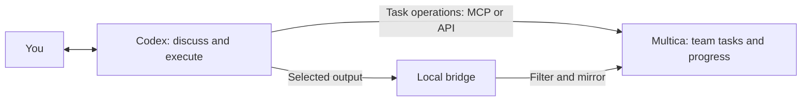

# Multica Bridge

[简体中文](README.zh-CN.md)

**Work in Codex. Share progress in Multica.**

A small, unofficial local bridge built on [Multica](https://github.com/multica-ai/multica).
Codex is the conversation and execution entry; Multica keeps the team's shared
tasks and progress. The agent follows a lightweight workflow, using MCP tools
and the authenticated API for operations the tools do not cover.

The bridge adds reliable synchronization, not another model. Connect when ready,
pause before private discussion, and resume into the same task and Chat without
uploading the paused interval. Each chat has one parent task; child tasks define
scope while execution records stay in the parent Chat.

## Get started

You need **Node.js 24+**, local Codex records, and a working Multica login.
Download or clone this repository, then ask your agent:

> Read docs/setup.md and help me install and configure this bridge locally.
> Check prerequisites, reuse my existing Multica login, and never print credentials.
> Register MCP and verify the connection. Do not synchronize this installation chat.

For installation commands, MCP configuration and a manual fallback, follow the
[setup guide](docs/setup.md). No server deployment or build step is needed for
the bridge; Multica runs separately.

## Use it in your existing chat

- **“Create a Multica task for this work and start syncing.”** The agent recommends
  a product/project label and a task-nature label for you to confirm, creates the task, and connects this chat.
- **“Pause Multica sync.”** Send this separately; wait for confirmed pause before
  continuing with private discussion.
- **“Resume Multica sync.”** Reuses the original task and Chat; paused content stays local.

Task descriptions stay short. New tasks default to low priority and a human
owner. The agent can move work to in progress or review; you decide completion.
Connected Codex chat titles receive an `M-` prefix.

Only explicitly connected chats sync. User inputs appear as `用户消息`; visible
replies may still quote them. Uploaded content is available to your configured
server. Redaction is best effort. Start with a disposable task; see
[security](SECURITY.md) and [compatibility](docs/compatibility.md).

## More

- [How it works](docs/architecture.md) · [Agent instructions](AGENTS.md) · [中文说明](AGENTS.zh-CN.md)
- [Testing](docs/testing.md) · [Contributing](CONTRIBUTING.md)
- [MIT](LICENSE): commercial use allowed, with notices retained.
  Multica and Codex keep their own terms. This project is not affiliated with
  OpenAI or Index Labs. [Attribution](NOTICE) · [Sources](docs/provenance.md) · [License review](docs/compliance.md)

Experimental source release; npm publication is intentionally disabled.
