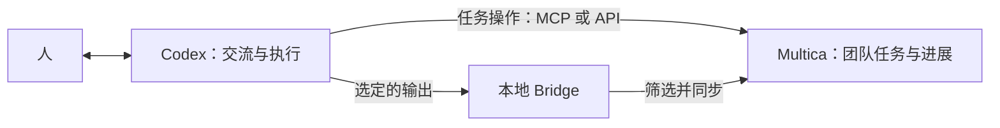

# Multica Bridge

[English](README.md)

**在 Codex 里工作，在 Multica 上协作。**

一个基于 [Multica](https://github.com/multica-ai/multica) 的非官方本地小工具。
Codex 承接人的表达与任务执行，Multica 保存团队共享的任务和进展。
Agent 按简短约定管理任务，优先用 MCP，未覆盖的操作通过已有登录调用接口。

Bridge 负责可靠同步，不再调用另一个模型。需要时连接，私密讨论前暂停，
随后恢复到原任务和 Chat，暂停期间的内容不补传。
一个聊天绑定一个父任务；子任务划分范围，执行记录仍留在父任务 Chat。

## 开始使用

需要 **Node.js 24+**、本地 Codex 记录，以及已登录的 Multica。
下载或克隆本仓库后，可以直接告诉 Agent：

> 阅读 docs/setup.zh-CN.md，帮我在本机安装配置这个 Bridge。
> 检查环境，复用已有 Multica 登录，不要输出凭据。
> 配置 MCP 并验证连接，不要同步这段安装对话。

安装命令、MCP 配置和手工备用路径见[安装说明](docs/setup.zh-CN.md)。
Bridge 不需要构建或部署服务端，Multica 单独运行。

## 在当前聊天使用

- **“为这项工作创建 Multica 任务并开始同步。”** Agent 建议项目区标签，
  由你选择后创建任务，再连接当前聊天。
- **“暂停 Multica 同步。”** 单独发送，等确认暂停后，再继续私密讨论。
- **“恢复 Multica 同步。”** 复用原任务和 Chat，不补传暂停内容。

任务描述保持简短，默认低优先级、人员负责人。Agent 可以设为进行中或审核中，
是否完成由你决定。已连接的 Codex 对话标题会加上 `M-`。

只同步明确连接的聊天。用户输入显示为“用户消息”，回复仍可能引用你的内容。
上传内容可被所配置的服务器访问；脱敏是尽力处理。建议先用可丢弃任务验证，
详细限制见[安全说明](SECURITY.md)和[兼容说明](docs/compatibility.md)。

## 更多

- [工作原理](docs/architecture.md) · [中文 Agent 约定](AGENTS.zh-CN.md)
- [测试](docs/testing.md) · [参与贡献](CONTRIBUTING.md)
- [MIT](LICENSE)：允许商用，保留版权及许可声明即可。
  Multica、Codex 仍适用各自条款。本项目与 OpenAI、Index Labs 无官方关联。
  [第三方署名](NOTICE) · [来源](docs/provenance.md) · [许可核验](docs/compliance.md)

当前为实验性源码版本，暂不发布 npm 包。
