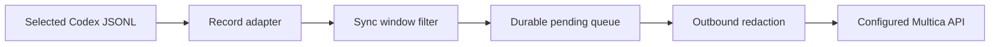
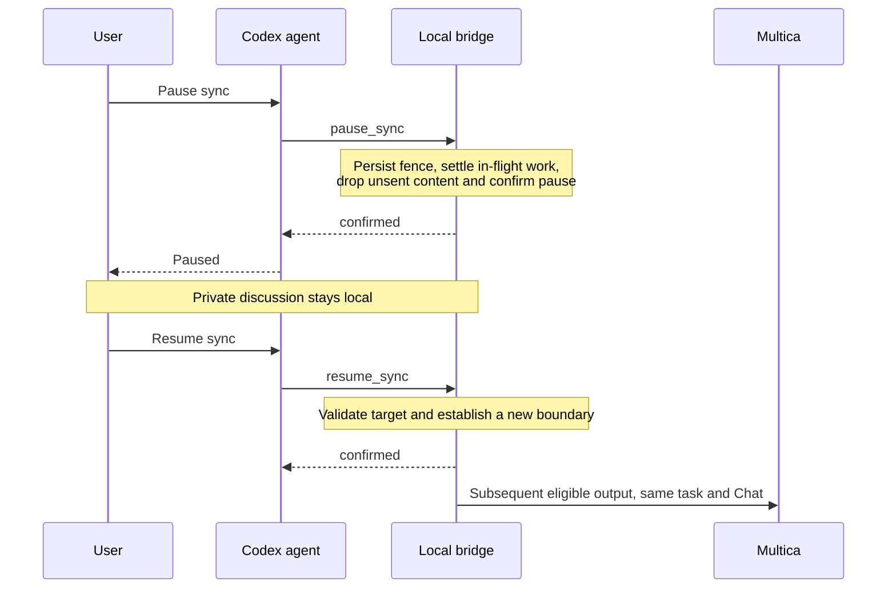

# Architecture

Source modules remain flat; there is no build layer or monorepo framework.

| Modules | Responsibility |
| --- | --- |
| mcp / cli | Stdio and command-line entry points, argument validation |
| workflow | Shared model instructions for MCP initialization and get_workflow |
| control / daemon | Process lifecycle, status, operation submission and main loop |
| operations / fences | Durable connect/pause/resume state, generation guards, send barriers |
| bindings | Selected-chat records, cursor metadata and status projection |
| engine | Reliable queue consumption, Chat/run creation, sending and completion |
| source / windows | Local Codex record adapter, window boundaries, newly eligible events |
| client-gate / client-lifecycle | Exact process-presence checks, network gating and closed-period skipping |
| tasks | Task/child-task metadata, association and comments |
| registry / profiles | Shared private runtime, mirror identity and configuration versions |
| api / privacy / secret-patterns | HTTP, outbound redaction and attributed token-format rules |
| config / storage | Deployment configuration, atomic JSON writes and process locks |

`engine` and `operations` import the independent `bindings` and `fences` modules,
not each other. MCP and CLI entry paths and the on-disk sync format remain stable.
Deployment data is kept separate from source; no real server or workspace is
encoded in the public configuration example. Optional project-label hints belong
to deployment configuration rather than the generic model workflow.

## Data path

Task metadata operations use the API client and its outbound redaction directly;
they do not pass through the transcript queue.

Only explicit bindings are read. The source index is metadata-only and read-only;
the selected transcript is never rewritten. Reasoning, injected environment,
internal review/subagent chats and bridge-control payloads are excluded. Raw user
input is replaced by a placeholder at the outbound message boundary. Visible
replies and enabled tool output may still quote private input.

## Controls and lifecycle

A control operation persists its identity and immediate send fence. The daemon
settles earlier in-flight work and returns an acknowledgement after admission
state is durable. `pending` and `failed` do not imply safe success. Pause drops
unsent queue content; resume starts at a newly confirmed complete-file boundary,
keeping the original task and Chat. Already-delivered content cannot be recalled.

Connect and resume validate that the remote target is still top-level before
committing a new association or reopening the window. A rejected new target does
not strand a wrong task key. Generations reject stale calls and request IDs make
operation retries idempotent. Chat creation separates not_sent / unknown /
confirmed, reconciling unknown outcomes rather than blindly duplicating objects.

With configured application following, quit closes the network gate. Reopen
preserves accepted pre-close queue data while skipping newly produced closed-time
records. Manual pause remains paused. A bridge-process restart preserves runtime
identity, bindings, operation records and pending state.

The diagram shows successful operations. A pending or failed result requires
inspection; it is not a pause confirmation. Resume does not backfill the private
interval, and pause cannot retract writes already sent.

## Tasks and privacy

One chat has one top-level task/Chat. Child tasks track separate scope and state;
they do not launch an agent, receive a separate Chat, duplicate the transcript or
automatically propagate status. Transport completion is independent of business
completion. Human ownership and suppress_run avoid a second platform execution.

Updates retain optimistic-concurrency bases. Outbound redaction filters business
content, not routing IDs, revisions or original description bases; the latter can
resend already-stored remote text to the same server. No automatic history cleanup,
filesystem isolation or server-blind encryption is provided.

API readback confirms stored data, not page rendering or another client's receipt.
Visibility and retention are ultimately controlled by the configured server.
See SECURITY.md for operational limits and docs/testing.md for regression and
development-only integration procedures.
